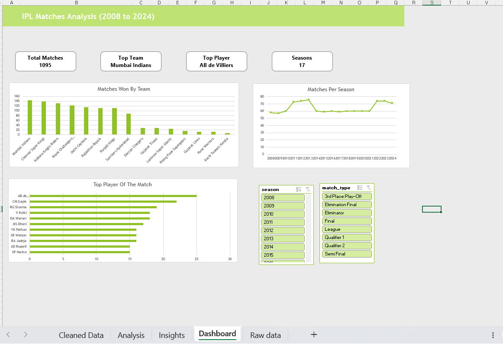

# IPL Matches Analysis (2008-2024) | Excel Project

An end-to-end Excel project on IPL match data: cleaning a messy dataset, analysing it with Pivot Tables, and presenting the results in an interactive dashboard.

## Dashboard

## Dataset

- **Source:** [IPL Complete Dataset 2008-2024](https://www.kaggle.com/) (Kaggle, by Patrick B), using `matches.csv`
- **Size:** 1,095 matches across 17 seasons

## Project Files

| File | Description |
|------|-------------|
| [ipl working data.xlsx](ipl%20working%20data.xlsx) | Final workbook with Raw data, Cleaned Data, Analysis, Insights and Dashboard sheets |
| [iplrawdata.csv](iplrawdata.csv) | Original raw data, untouched |
| [Dashboard.png](Dashboard.png) | Dashboard screenshot |

## Data Cleaning

The raw data had inconsistent and missing values, so I cleaned it in a separate sheet and kept the raw data untouched:

- Merged renamed team names into one name each (for example Delhi, Punjab, Royal Challengers, Rising Pune) and changed Bangalore to Bengaluru
- Replaced NA values with meaningful labels: "No DLS" (method), "No Result" (winner), "No Awards" (player of the match)
- Cleared NAs in result margin, target runs and target overs to blanks
- Filled 51 missing cities from the venue (Dubai, Sharjah)
- Converted season labels to plain years
- Standardized venue names by removing city suffixes and merging variants
- Checked for duplicate match ids (none found)
- Converted the data into an Excel Table (`tblMatches`)

## Analysis

Pivot Tables built for:
- Wins by team
- Top players of the match
- Tosses won by team
- Whether the toss winner also won the match
- Toss decision vs result
- Matches per season

## Dashboard Features

- KPI cards: Total Matches, Top Team, Top Player, Seasons
- Charts: Matches Won By Team, Matches Per Season, Top Player Of The Match
- Slicers for **season** and **match type**, connected to all pivots and KPI cards

## Key Insights

- **Toss decision:** Teams that chose to field after winning the toss won 53.55% of their matches, compared to 45.27% for teams that chose to bat.
- **Toss and match result:** Toss winners went on to win the match 50.59% of the time (554 out of 1,095 matches). This is only slightly above 50%, so winning the toss gives very little advantage.
- **Most successful team:** Mumbai Indians have the most wins with 144 (about 13.2% of the 1,090 matches that produced a result), followed by Chennai Super Kings (138) and Kolkata Knight Riders (131). Teams like Gujarat Titans and Kochi Tuskers Kerala have far fewer wins because they played only a few seasons.
- **Player of the Match:** AB de Villiers has the most awards with 25, followed by Chris Gayle (22) and Rohit Sharma (19). After the top two, the gaps are small, so no player dominates this record.
- **Matches per season:** The IPL started with 58 matches in 2008, then rose to 73-76 between 2011 and 2013 when more teams joined. It settled at around 60 from 2014 to 2021 with 8 teams, and rose again to 74 in 2022 when Lucknow Super Giants and Gujarat Titans were added.

## Tools Used

Microsoft Excel: Tables, Find and Replace, Pivot Tables, Pivot Charts, Slicers, formulas, custom theme

## Author

**Shazin TM** | [LinkedIn](https://www.linkedin.com/in/shazin-tm) | [GitHub](https://github.com/Shazin-tm)
